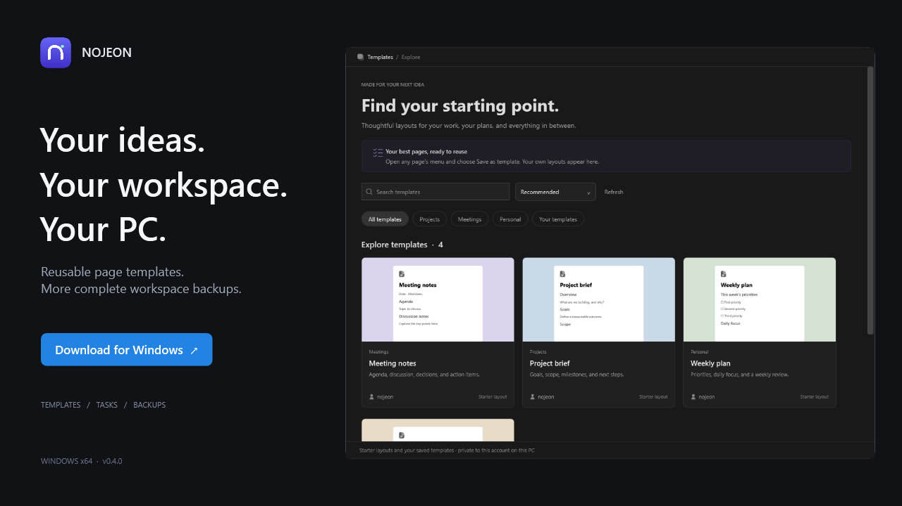
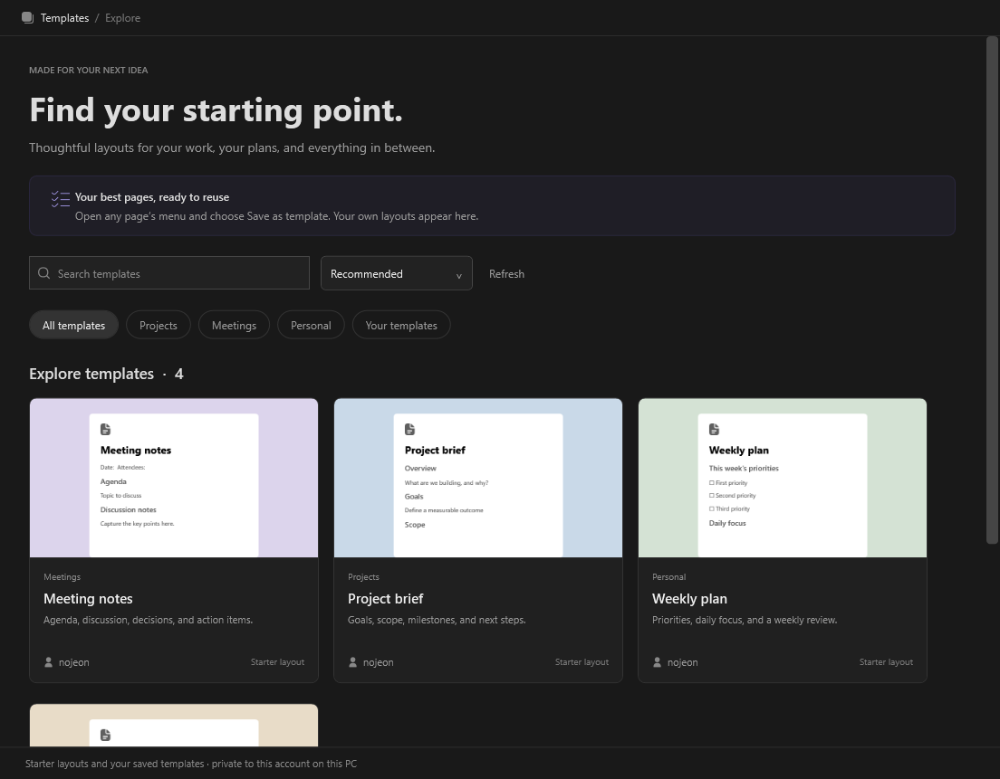
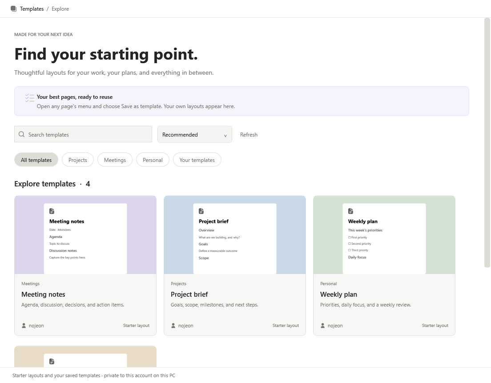
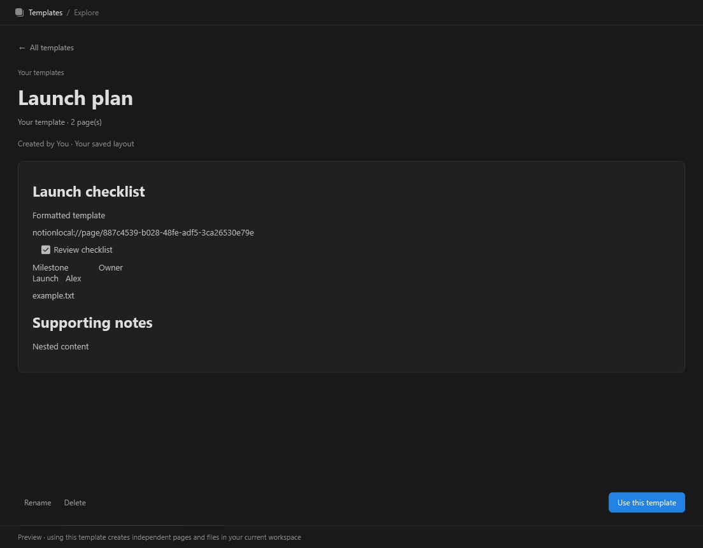
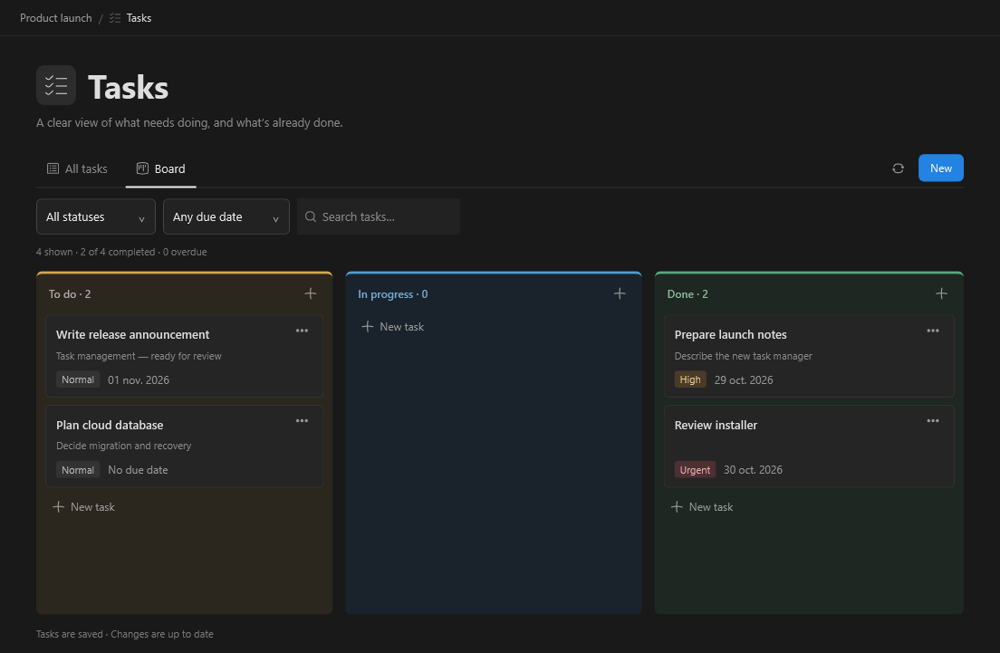
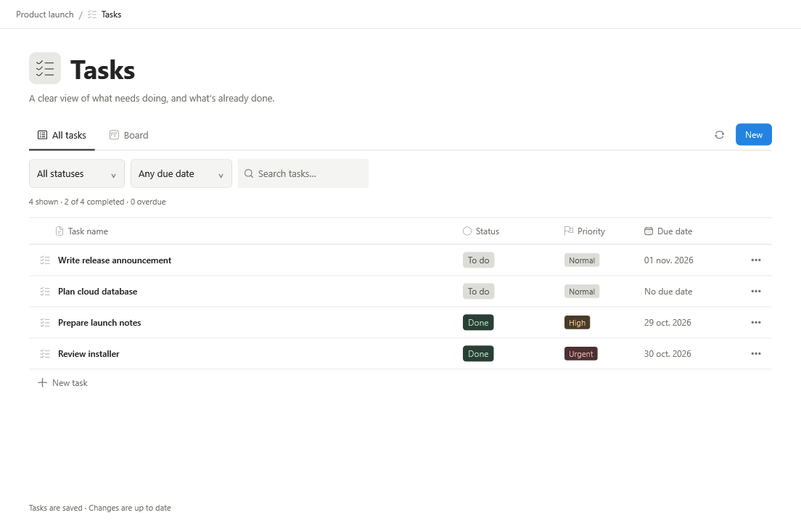
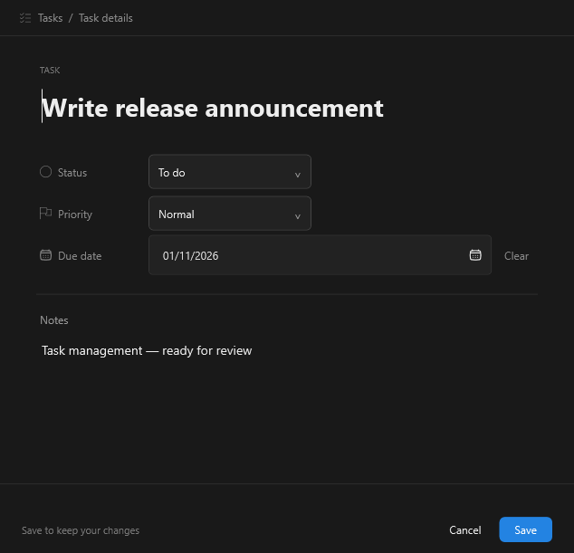
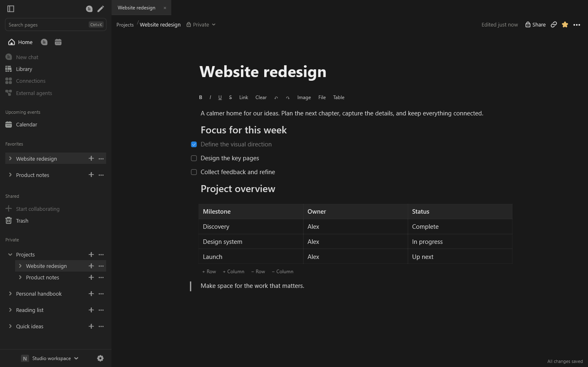
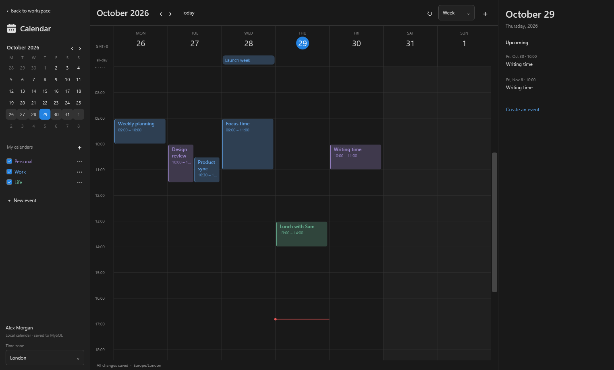
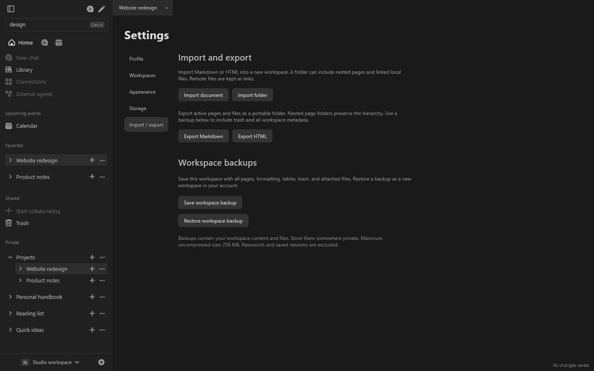

<h1 align="center">nojeon</h1>

<strong>A little more space for your ideas.</strong> Notes, tasks, projects, and a calendar in one focused Windows workspace.

  
  
  

<a href="https://github.com/deman404/nojeon-updates/releases/tag/v0.4.0">Release notes &amp; checksum</a> &nbsp;·&nbsp; <a href="docs/INSTALLATION.md">Installation guide</a> &nbsp;·&nbsp; <a href="docs/USER-GUIDE.md">User guide</a>

**Before you download:** this desktop preview requires **Windows x64 and a separately installed MySQL Server 8+**. The .NET runtime is included. The installer is currently unsigned; see [release details](https://github.com/deman404/nojeon-updates/releases/tag/v0.4.0) before installing.

## New in 0.4.0: a head start for every page

Browse a gallery of starter layouts and your own saved templates. Search, filter categories, and open a card to explore its layout. Choose **Use this template** to create an independent page—or save your best page from **··· > Save as template**.

Explore Light mode and template details

### More complete backups

Workspace archives now include the selected workspace’s tasks and **all calendars/events for your account**, along with pages and files. Restore creates a new workspace and separate calendar copies. Older page-only archives remain supported.

[Template guide](docs/TEMPLATES.md) · [Backup guide](docs/BACKUPS.md) · [Release notes](https://github.com/deman404/nojeon-updates/releases/tag/v0.4.0)

## Manage tasks your way

Switch between a compact task table and a colored Kanban board. Give each task a priority, due date, and notes; search and filter your list, then move tasks from **To do** to **In progress** to **Done**. Tasks stay with their workspace and save to your configured database.

See task details

[How to use Tasks](docs/TASKS.md)

## Make room for the work that matters

Capture a quick thought, build a project plan, or collect everything you need for your next idea. nojeon brings flexible pages, rich writing tools, and a local calendar together in a native Windows app.

### Write it your way

Start with a blank page and make it yours. Combine headings, checklists, notes, code, images, attachments, and editable tables. Nest pages to give each project a home, and pin favorites to keep them close.

### Keep your day in view

Switch between day, three-day, week, and month views. Create colored calendars, schedule repeating events, and link the notes you need. Drag events to move them or resize their time slots.

### Find your flow

| When you want to… | nojeon helps you… |
| --- | --- |
| Bring order to a project | Organize nested pages, favorites, and separate workspaces |
| Work across a few ideas | Open page tabs and keep a reference alongside your writing with side peek |
| Find something again | Search page titles, content, tables, and attachment names with **Ctrl+K** |
| Keep writing | Use autosave, visible save status, undo/redo, and encrypted recovery drafts |
| Bring existing notes | Import Markdown or HTML documents and folders |
| Take a copy with you | Export pages or save a portable workspace backup |
| Make it feel comfortable | Choose Light or Dark, reading width, and editor text size |

### Keep a copy of your work

Import your existing notes, export a page, or save a workspace archive with its pages and attached files. Restore an archive into a new workspace when you need it.

Version 2 workspace archives include workspace tasks and all account calendars/events. They are not encrypted; keep them private. Saved template libraries stay on this PC and are not part of workspace archives. See the [backup guide](docs/BACKUPS.md).

## From download to your first page

1. **Install nojeon.** [Download the Windows installer](https://github.com/deman404/nojeon-updates/releases/download/v0.4.0/nojeon-0.4.0-win-x64-Setup.exe), run it, and open nojeon from the Start menu.
2. **Connect your database.** Install and start [MySQL Community Server 8+](https://dev.mysql.com/downloads/mysql/), then enter your connection details in nojeon. Choose **Test connection**, then **Create / update database and continue**.
3. **Create your app account.** Sign in and create your first page from the sidebar. Your nojeon account is separate from a notion.com account.

Installation is per Windows user. You do not need the .NET SDK. Use a dedicated MySQL database and back up existing databases before schema updates.

Need more detail? Follow the [installation guide](docs/INSTALLATION.md) or explore the [user guide](docs/USER-GUIDE.md).

## Your workspace, clearly explained

**Where your data lives.** Accounts, pages, tasks, and calendar records use your configured MySQL database. Imported files, preferences, and encrypted recovery drafts stay on your PC. Protected local settings use Windows protection for your Windows account.

**What this preview includes.** The current downloadable version is **0.4.0**, with rich pages, reusable page templates, workspace tasks, a local calendar, and planning backups. It bundles a .NET 11 release-candidate runtime.

**What is coming next.** Cloud database support is the next planned milestone. Collaboration, AI, Google sign-in, and external calendar synchronization are not available in this preview. See the [roadmap](ROADMAP.md) for planned work.

**Checking your download.** The [release page](https://github.com/deman404/nojeon-updates/releases/tag/v0.4.0) includes the installer SHA-256 and a PowerShell command to check it. Download the `.exe` under Assets to install the app. GitHub's automatic “Source code” archives contain this repository's documentation.

### Upgrading from an earlier version

Back up your MySQL database and local files, close nojeon, and run the new installer. Apply any pending database updates, then open **Templates** from the sidebar. Version 0.4.0 itself introduces no new database migration. See the [upgrade instructions](docs/INSTALLATION.md).

## Follow along

[Product updates](CHANGELOG.md) · [All releases](https://github.com/deman404/nojeon-updates/releases) · [Roadmap](ROADMAP.md) · [Report a problem](https://github.com/deman404/nojeon-updates/issues/new/choose)

Found something that could be better? Open an issue with your app version, Windows version, and steps to reproduce. Remove private content from screenshots and keep database credentials, session files, and workspace backups out of public issues.

---

<strong>Your ideas. Your workspace. Your PC.</strong> Independent Windows app. Not affiliated with Notion Labs, Inc. This repository is the public home for nojeon downloads, documentation, and product updates.

