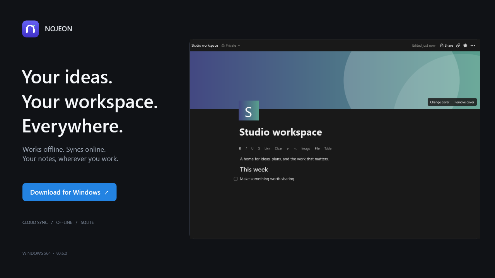
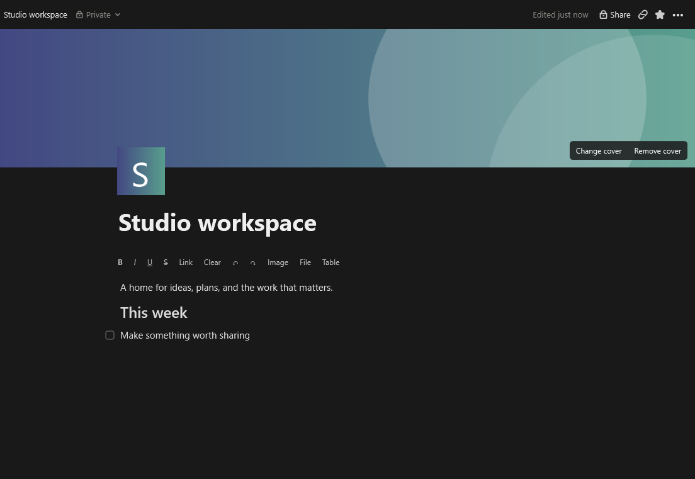
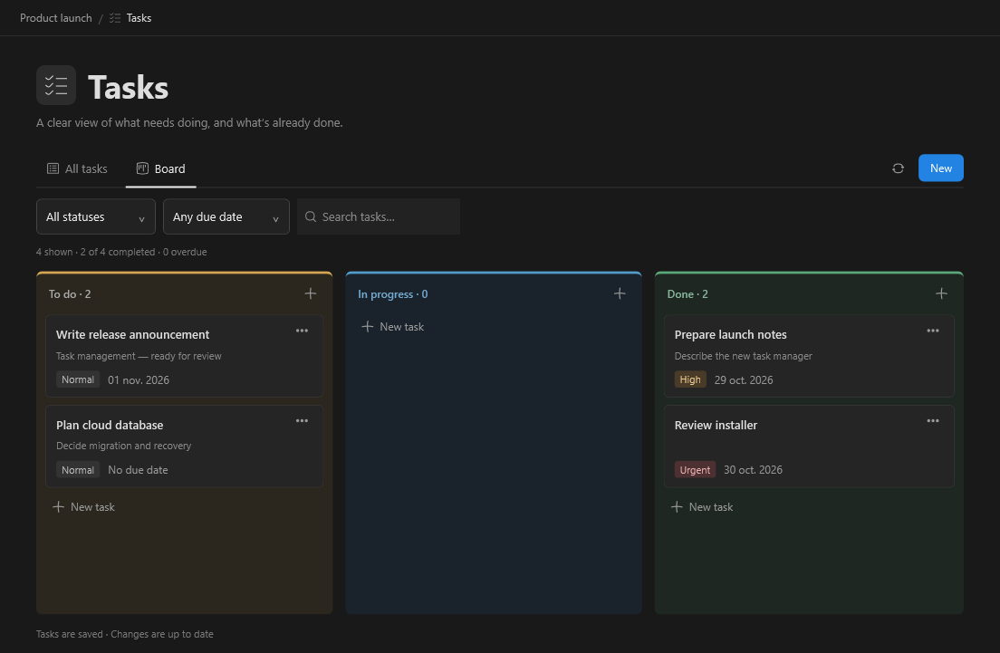
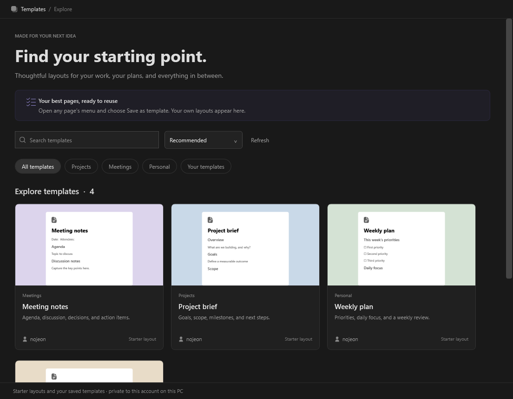
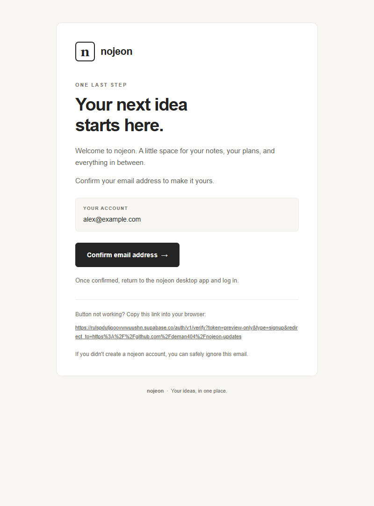

<h1 align="center">nojeon</h1>

<strong>Your ideas. Your workspace. Wherever you work.</strong> Notes, tasks, projects, and a calendar in one focused Windows app.

<a href="https://github.com/deman404/nojeon-updates/releases/tag/v0.6.0">Release notes</a> &nbsp;·&nbsp; <a href="https://github.com/deman404/nojeon-updates/releases/download/v0.6.0/SHA256SUMS.txt">Checksums</a> &nbsp;·&nbsp; <a href="docs/INSTALLATION.md">Installation guide</a> &nbsp;·&nbsp; <a href="docs/USER-GUIDE.md">User guide</a>

**For Windows x64.** The runtime is included. An internet connection is needed
for first-time signup/login; after that, your cached workspace works offline.
**No MySQL installation or database setup is required.** This is an unsigned
desktop preview using the project's .NET 11 release-candidate runtime.

## New in 0.6.0: your workspace, connected

Your notes should be ready when you are. nojeon now saves your work to SQLite
on your PC and syncs it privately through Supabase when you're online.

- **A cloud account:** email signup, confirmation, login, and protected saved sessions.
- **Offline editing:** pages, tasks, and calendars save locally, with pending changes kept across restarts.
- **Your files, too:** attachments, page artwork, and saved templates sync between devices.
- **A clear save status:** distinguish **Saved on this PC** from **Synced**.
- **Recovery when edits collide:** choose this PC or the cloud, with the replaced version kept in recovery.

[How cloud and offline work →](docs/CLOUD-SYNC.md)

## Make room for your ideas

| In your workspace | What you can do |
| --- | --- |
| **Notes and pages** | Write with rich blocks, tables, checklists, images, attachments, and nested pages |
| **Tasks** | Plan in a list or colored Kanban board, with status, priority, notes, and due dates |
| **Calendar** | Keep colored calendars, recurring/all-day events, and links to your notes |
| **Templates** | Start from a ready-made layout or save your own reusable page template |
| **Page artwork** | Add a cover, choose from 205 color emoji, or upload your own page logo |
| **Find and organize** | Search your workspace, use favorites, and open tabs or side peek |
| **Take a copy** | Import/export Markdown or HTML and save portable workspace backups |

<strong>See tasks, templates, and the confirmation email</strong>

Screenshots use sample content. The thumbnail combines an actual app capture with
native text and branding.

## Download and start

| Package | Download |
| --- | --- |
| Windows installer | [nojeon-0.6.0-win-x64-Setup.exe](https://github.com/deman404/nojeon-updates/releases/download/v0.6.0/nojeon-0.6.0-win-x64-Setup.exe) |
| Portable ZIP | [nojeon-0.6.0-win-x64-portable.zip](https://github.com/deman404/nojeon-updates/releases/download/v0.6.0/nojeon-0.6.0-win-x64-portable.zip) |
| SHA-256 checksums | [SHA256SUMS.txt](https://github.com/deman404/nojeon-updates/releases/download/v0.6.0/SHA256SUMS.txt) |

1. Install nojeon, or extract the portable ZIP and open `nojeon.exe`.
2. Create an account, confirm the email, then return to the app and log in.
3. Start a page, add a task, or plan an event.
4. Sign in with the same account on another PC to download your workspace.

This is an independent app with its own accounts, separate from notion.com.
[Installation and troubleshooting](docs/INSTALLATION.md).

## Upgrading from the local edition

**Export your work before upgrading.** In 0.5.0, save a `.notionbackup` archive
for each workspace from **Settings / Import and export**. In 0.6.0, create your
cloud account and restore those archives from the same settings page.

Pages, files, tasks, and calendars are remapped to the new account. Old local
accounts do not automatically become cloud accounts. Existing MySQL databases
and legacy local files are left untouched. Old saved template libraries are
separate from workspace backups and do not migrate automatically.

[Backup and migration guide](docs/BACKUPS.md).

## What to know about this preview

- Sync uses account snapshots, with a choice when two devices make divergent edits.
  It does not merge individual keystrokes or provide shared workspaces.
- Google OAuth, AI features, Google/iCloud calendar connections, and collaboration
  are not enabled.
- Appearance preferences stay on each PC.
- Cloud snapshots allow 16 MiB of structured content; file uploads are subject to
  app/project limits. See [cloud sync details](docs/CLOUD-SYNC.md).
- SQLite caches, recovery copies, and exported backups contain workspace content.
  There is no end-to-end encryption; keep backups private.
- Superseded cloud files and local recovery copies are retained without automatic cleanup.

This public repository contains release downloads, instructions, and updates.
The automatic source ZIPs contain these public documents, not the desktop app's
private source code.

[All updates](CHANGELOG.md) · [Roadmap](ROADMAP.md) · [Report an issue](https://github.com/deman404/nojeon-updates/issues)
---

Emoji artwork: [Twemoji](https://github.com/jdecked/twemoji), Twitter, Inc. and contributors,
licensed under [CC BY 4.0](https://creativecommons.org/licenses/by/4.0/).
Independent Windows app. Not affiliated with Notion Labs, Inc.
